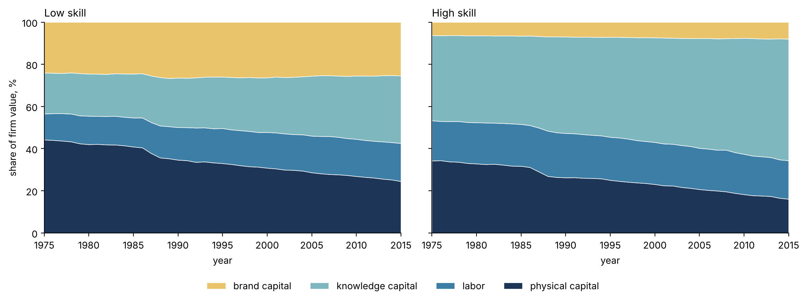

# firmvalue

Splits a company's market value into physical capital, labor, knowledge capital and brand
capital, following Belo, Gala, Salomao and Vitorino (2022). Library, CLI, MCP server, Claude
Code plugin.

[](https://github.com/lisaperrin/firm-value-decomposition/actions/workflows/ci.yml)


```text
$ firmvalue live NVDA
NVDA  fiscal 2026  millions of USD, employees in thousands
observed value 4,645,419   implied 621,693   book 77,056   ratio 60.29 observed, 8.07 implied

 input        stock       q   book %   market %
 ──────────────────────────────────────────────
 physical    13,250    2.19     17.2        4.7
 labor           42   94.80      0.0        0.6
 knowledge   61,532    9.45     79.9       93.5
 brand        2,274    3.20      3.0        1.2

parameters  illustrative calibration, not estimated on real data
note  advertising proxied as 30% of SG&A; Yahoo publishes no advertising line
note  knowledge and brand stocks initialised from the first of 4 observed years at 3% pre-sample growth
note  headcount is the latest value carried across all years; hiring equals replacement of
separations, so the labor share is a rough figure
```

I started this after the paper came up in a corporate finance lecture. The trick behind it is
old (Hayashi 1982): if production and adjustment costs have constant returns to scale, firm
value equals the sum over inputs of installed stock times shadow value. Nothing is left
over, so you can ask what fraction of a company is its R&D stock or its workforce and get a
number out of the model. The paper estimates this on Compustat, which I don't have access
to. So the repo has a simulator that draws panels from the model, an estimator that recovers
the parameters from those panels, and an adapter for Compustat in case you do have it. Live
mode gets real statements through [marketlens](https://github.com/lisaperrin/marketlens).

None of the numbers in here are empirical results. The demo is synthetic, and live mode
applies parameters instead of estimating them.

## Install

Needs Python 3.12+ and [uv](https://docs.astral.sh/uv/).

```bash
git clone https://github.com/lisaperrin/firm-value-decomposition
cd firm-value-decomposition
uv sync --extra live          # drop --extra live if you don't want marketlens
uv run firmvalue --help
```

## Usage

```bash
firmvalue demo --out-dir outputs                     # simulate, estimate, decompose, plot
firmvalue simulate --out panel.csv --firms 400
firmvalue estimate panel.csv --out parameters.json
firmvalue shares panel.csv parameters.json
firmvalue figure panel.csv parameters.json --out shares.png
firmvalue prepare funda.csv --out panel.csv          # Compustat Fundamentals Annual
firmvalue live NVDA SAP.DE --parameters parameters.json
```

`--json` before the command gives JSON, the same dicts the MCP tools return. Errors print
one line and exit 1.



The figure is what `firmvalue demo` produces: 800 synthetic firms over 1975 to 2015, in two
groups whose capital mix is set up to look like the paper's low- and high-skill industries.
The kink around 1987 is the 1986 tax reform. The statutory rate goes from 46 to 34 percent in
two steps and every shadow value moves with it.

## The model

Stocks follow $X_{j,t+1} = (1-\delta_j)X_{j,t} + I_{j,t}$ for $j \in \{K, L, N, B\}$:
physical capital, labor (hires in, separations out), knowledge capital from R&D, brand
capital from advertising. Adjusting input $j$ costs

$$C_j = \frac{\theta_j}{\nu_j}\left|\frac{I_j}{X_j}\right|^{\nu_j} X_j ,$$

quadratic at $\nu_j = 2$. Profit and adjustment costs are homogeneous of degree one, so
Hayashi's result holds input by input:

$$V_t = \sum_j q_{j,t}\,X_{j,t+1}.$$

Each $q_j$ is the after-tax marginal cost of one more unit. Capex is capitalised, so a unit
costs 1. R&D and advertising are expensed, so a unit costs $1-\tau$. Labor has no purchase
price at all, just the hiring cost.

$$q_K = 1 + (1-\tau)\,\theta_K r_K^{\nu_K-1}, \qquad
q_N = (1-\tau)\big(1 + \theta_N r_N^{\nu_N-1}\big), \qquad
q_L = (1-\tau)\,\theta_L h^{\nu_L-1},$$

where $r_j = I_j/X_j$ is the investment rate, $h$ the hiring rate, and $q_B$ has the same form
as $q_N$. The market share of input $j$ is $q_j X_j / V$. Book shares divide each capital
stock by $K+N+B$. Labor has no book value, which is why that cell is zero in the paper's
Table 2.

### Estimation

The thing being fitted is the valuation ratio $V / (K+N+B)$. With quadratic costs the model
version of that ratio is linear in the $\theta_j$, so the estimator is plain non-negative
least squares. If you also estimate the curvatures $\nu_j$, the NNLS solution is the starting
point for a bounded trust-region solve. Standard errors are clustered by firm. Fit is
reported three ways, all as $1 - SSR/SST$:

- pooled, over every firm-year;
- time series, the annual aggregate ratio against its model value;
- cross section, averages over ten portfolios formed each year on the previous year's
  observed ratio (lagged, so the sorting variable isn't the thing being fitted).

I should say that these are my fit measures. They are meant to answer the same question as
the paper's moment conditions but they are not the same moments.

On the demo panel (400 firms per group, seed 0) the low-skill group comes back as 2.11 (0.14),
845 (29), 33.5 (0.6), 7.04 (0.14) against true values of 2, 900, 32, 7, in the order physical,
labor, knowledge, brand, standard errors in parentheses. The labor parameter is in millions
per thousand employees. At a 13 percent hiring rate and a 35 percent tax rate, 900 works out
to roughly 76 thousand dollars per installed employee.

## Live mode

```bash
uv sync --extra live
firmvalue live NVDA
firmvalue live NVDA AMD INTC --years 4 --parameters parameters.json --brand-share 0.3
```

`live` calls marketlens' `get_statements` for a few fiscal years of balance sheet, income
statement and cash flow lines, builds the four stocks from them and decomposes the latest
year. The JSON output has all years. How each stock is built, and the shortcuts involved:

- physical capital: net PP&E; flow: capex.
- knowledge capital: R&D accumulated at 15 percent depreciation, with the opening stock
  backed out of the first observed year. With only four years that opening stock dominates,
  and the output says so.
- brand capital: a share of SG&A (30 percent by default, `--brand-share`) at 50 percent
  depreciation. Yahoo doesn't publish an advertising line, so this is a proxy.
- labor: the latest headcount, carried across all years because yfinance has no headcount
  history. Hiring then equals replacement of separations, and the labor share should be
  read as rough.
- market value: year-end price × shares + debt, `--net-of-cash` optional.
- tax: US statutory schedule unless `--tax-rate`, with a note for non-US filers.

Four years of one firm can't identify four parameters, so `live` doesn't try. It applies a
parameter file from `estimate` if you give it one, otherwise an illustrative calibration
that it labels as such in the output. Observed and implied valuation ratios are printed next
to each other on purpose. For SAP they are close. For Nvidia they are a factor of seven
apart, which tells you the illustrative parameters are nowhere near pricing Nvidia, not that
the identity is wrong.

marketlens is an optional extra, `firmvalue[live]`, pinned to tag `v0.3.1` in
`[tool.uv.sources]`. firmvalue only depends on the shape of its `Statements` record (a
`Protocol`), so the tests run without marketlens installed and without network access.

## Compustat

`firmvalue prepare` reads a Fundamentals Annual CSV with the mnemonics `gvkey fyear prcc_f
csho dltt dlc ppent capx xrd xad emp`, plus `che` and `sic` if present. Market value is
`prcc_f × csho + dltt + dlc`. Knowledge and brand stocks are perpetual inventory on `xrd` and
`xad` with missing flows as zero. Hires are the change in `emp` plus 10 percent separations.
Tax is the top statutory federal rate for `fyear`. Financials (SIC 6000s) and utilities
(4900s) are dropped, as are firms with under three usable years. Pass a `group` function to
`from_compustat` to label firms by industry skill, and `estimate` fits each group and the
pool.

## Claude Code

```text
/plugin install firmvalue --marketplace lisaperrin/firm-value-decomposition
```

Installs:

- MCP server `firmvalue` with `estimate_parameters`, `value_shares`, `decompose_firm`,
  `decompose_live`, `simulate_demo_panel`, `published_value_shares`. Started with `uvx
  --from <plugin>[live]`, so uv has to be on PATH and git needs to reach the marketlens
  repo. First start takes a minute.
- Skills: `/firmvalue:live`, `estimate`, `decompose`, `explain-model`.
- Agent `structural-reviewer`: checks the shadow-value algebra, the value identity, the
  estimator and the simulator against the model as written and the tests that pin it.
- A session-start hook that lists the tools.

The plugin uses marketlens as a library, not as a plugin, so you don't need the marketlens
plugin installed for this one to work.

## Layout

```text
src/firmvalue/
  inputs.py       Input enum, InputSpec (depreciation, expensed, purchased)
  model.py        AdjustmentCost, Parameters, shadow_values, decompose
  estimation.py   NNLS seed, least_squares, clustered SEs, FitStatistics
  simulate.py     GroupDesign, SimulationDesign, simulate_panel
  capital.py      perpetual inventory      tax.py   statutory rates      panel.py  schema
  compustat.py    Compustat adapter        live.py  marketlens statements to panel
  io.py           files, share tables      report.py  rich tables      plotting.py  figure
  reference.py    the paper's Tables 2 and 4
  cli.py          Typer                    mcp_server.py  same functions as the CLI
```

Things to know before changing code:

- Panels hold end-of-year stocks and the year's flows. The investment rate uses the opening
  stock recovered from the law of motion, `(X_end - I) / (1 - δ)`.
- Capital in money units, labor in thousands of employees. Live mode converts Yahoo's raw
  amounts to millions so the same parameters apply.
- Shares are fractions in the library, percent in every table and tool result.
- `implied_value == sum(q_j * X_j)` is tested to machine precision for arbitrary parameters.
- Errors subclass `FirmValueError`. CLI prints one line and exits 1. MCP raises `ToolError`.

## Development

```bash
uv sync --all-groups --extra live
uv run pytest -q                                  # 106 tests, offline, ~4 s (1 needs the live extra)
uv run ruff check . && uv run ruff format --check . && uv run mypy
uv run python scripts/validate_plugin.py --with-claude-cli
```

ruff with line length 100, mypy strict, pytest with warnings turned into errors. CI runs on
3.12 and 3.13 without the live extra and then runs the demo. Each formula has a test with a
value worked out by hand. Two Monte Carlo tests simulate a panel and check that estimation
gives back the parameters it was generated with: exactly when there is no valuation noise,
within sampling error when there is. `.claude/settings.json` has two hooks for anyone working
on this in Claude Code, ruff after every edit and a block on `git push --force`,
`--no-verify` and `git reset --hard`.

Design notes, including approaches I considered and dropped, are in `docs/design.md`.

## Known gaps

The depreciation rates (10 / 10 / 15 / 50 percent) are the usual conventions, not estimates.
Tax depreciation allowances are ignored, so the price of physical capital is exactly 1.
Shares are equal-weighted across firms unless you ask for value weights. There is no
industry skill classification built in; if you want the paper's low/high-skill split you
have to supply it. In live mode brand capital is an SG&A share and headcount is a single
number. The illustrative parameters happen to price SAP reasonably and Nvidia badly, so for
anything serious, estimate your own on a panel.

## Reference

Belo, F., Gala, V. D., Salomao, J. and Vitorino, M. A. (2022). Decomposing firm value.
*Journal of Financial Economics* 143(2), 619–639.

## License

MIT. Market data in live mode comes from Yahoo via yfinance through marketlens, subject to
[Yahoo's terms](https://legal.yahoo.com/us/en/yahoo/terms/otos/index.html).
